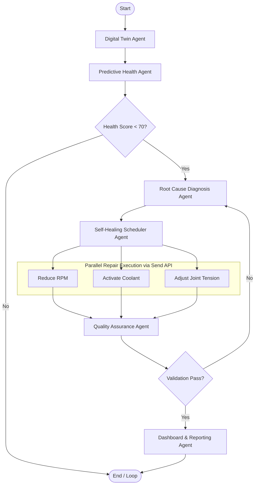

# ORION-FACTORY 🏭🤖
> *"Where factories heal themselves before they break."*

[](https://python.org)
[](https://reactjs.org)
[](https://langchain.com)
[](https://mujoco.org)

**ORION-FACTORY** is a state-of-the-art **Autonomous Self-Healing Digital Twin**. It simulates a robotic manufacturing environment in 3D physics (MuJoCo) and uses a swarm of 6 specialized AI agents (powered by LangGraph and Grok/Llama 3.2) to instantly detect, diagnose, and repair hardware failures in real-time—completely eliminating human-in-the-loop downtime. 

The entire system is monitored and controlled through a **high-performance React 18 dashboard**, featuring **Three.js** for real-time 3D simulation rendering and **Plotly.js** for sub-second telemetry visualization.

This document explains **everything** about this project—from the fundamental problem in manufacturing to the complete code architecture and the journey of an anomaly. 

---

## Table of Contents
1. [The Core Problem: Unplanned Downtime](#1-the-core-problem-unplanned-downtime)
2. [Our Solution: Autonomous Self-Healing](#2-our-solution-autonomous-self-healing)
3. [Key Features & Innovations](#3-key-features--innovations)
4. [Architecture & LangGraph StateGraph](#4-architecture--langgraph-stategraph)
5. [The 6 Specialized AI Agents](#5-the-6-specialized-ai-agents)
6. [The Journey of an Anomaly (Deep Dive)](#6-the-journey-of-an-anomaly-deep-dive)
7. [File Structure](#7-file-structure)
8. [Technology Stack](#8-technology-stack)
9. [Installation & Setup](#9-installation--setup)
10. [Running the Demo](#10-running-the-demo)
11. [Understanding the ROI Dashboard](#11-understanding-the-roi-dashboard)

---

## 1. The Core Problem: Unplanned Downtime
In modern manufacturing, speed is everything. However, when a machine fails on an automotive assembly line or a semiconductor fab, it causes **Unplanned Downtime**.

### Real-World Impact:
- **The Financial Bleed:** A single minute of unplanned downtime in a large auto factory can cost upwards of $10,000 to $20,000. 
- **The Human Bottleneck:** Today, most factories use basic "Predictive Maintenance" (Condition Monitoring). When a motor vibrates too much, a dashboard flashes a red light. The line stops. A human mechanic must notice the light, walk to the machine, run manual diagnostics, read a manual, and physically adjust settings to fix it. This human-in-the-loop delay often takes anywhere from 15 minutes to several hours.
- **The Gap:** Predicting a failure is no longer enough. The gap in the industry is the inability to *automatically heal* the failure before it brings down the production line.

---

## 2. Our Solution: Autonomous Self-Healing
**ORION-FACTORY** is a state-of-the-art orchestration platform that removes the human bottleneck entirely. 

Instead of just predicting failures, we use a **Multi-Agent AI Architecture** connected directly to a physical **Digital Twin** (simulated via MuJoCo). 

### What Our System Does:
```
Physical Machine / Digital Twin → [LangGraph AI Orchestrator] → Corrective Actions
                                            ↓
                              - Ingests IoT telemetry (Vibration/Temp)
                              - Diagnoses mechanical root cause
                              - Dispatches counter-measures (Self-Healing)
                              - Validates success mathematically
```

---

## 3. Key Features & Innovations

- **🧠 Zero-Shot Causal Diagnosis:** Uses large language models (Grok / Llama 3.2) to translate raw sensor anomalies into human-readable mechanical root causes.
- **⚡ Millisecond Self-Healing:** Instantly dispatches parallel software countermeasures (like reducing RPM or boosting coolant) the moment an anomaly is detected.
- **🛡️ 3-Sigma Mathematical Safety:** Prevents false positives using strict Gaussian anomaly detection and Welch's t-test validation loops.
- **💰 Real-Time ROI Tracking:** Hardcoded financial models dynamically calculate and persist the exact dollar amount of factory downtime averted (tracked in SQLite).
- **🔒 Privacy-First / Air-Gapped:** Architecture supports dropping in local, on-premise models like Ollama for strict industrial data security.
- **🔄 Hardware Agnostic Retrofitting:** Factories can strap cheap IoT sensors to legacy machines and pipe the data into our LangGraph orchestrator to instantly grant their old machines self-healing capabilities.

---

## 4. Architecture & LangGraph StateGraph

Our orchestrator mimics a real human engineering team through a strict Separation of Concerns. The workflow starts with continuous physics simulation, checks predictive health, and triggers a self-healing loop in parallel if any anomaly is detected, followed by validation and dashboard reporting.

### StateGraph Flow


### State Schema (OrionState)
Our entire workflow is typed and managed through a single state schema:

```python
from typing import TypedDict, List

class OrionState(TypedDict):
    # Input Layer
    sensor_data: dict          # {"vibration": 0.5, "temp": 85}
    
    # Simulation Layer
    twin_state: dict           # MuJoCo position/velocity/torque data
    
    # Prediction Layer
    health_score: int          # 0-100
    failure_prob: float        # 0.0-1.0
    
    # Diagnosis Layer
    root_causes: List[str]     # Top diagnosed causes
    
    # Execution Layer
    repair_actions: List[dict] # Actions to take
    repair_status: str         # "PENDING", "RUNNING", "SUCCESS"
    
    # Validation Layer
    validation_result: bool    # True if repaired successfully
```

---

## 5. The 6 Specialized AI Agents

When deployed, our system operates through a team of 6 highly specialized AI agents that act as an autonomous engineering team:

1. **`Agent A1` (Digital Twin Perception):** Acts as the eyes and ears. It ingests live, high-frequency IoT sensor data (vibration, temperature, RPM) from physical machines via standard industrial protocols.
2. **`Agent A2` (Predictive Health):** The mathematician. It runs statistical algorithms (like 3-Sigma Gaussian anomaly detection) to instantly spot when a motor is overheating or vibrating out of bounds. If the math triggers, it initiates the safety protocol.
3. **`Agent A3` (Root Cause LLM):** The brain. Instead of just knowing a number is high, it uses advanced LLMs to perform "Zero-Shot Causal Evaluation." It diagnoses *why* it's happening (e.g., "Actuator bearing friction due to mechanical stress").
4. **`Agent A4` (Self-Healing Scheduler):** The manager. It formulates a parallel repair strategy and sends digital commands back to the machine's PLC (e.g., reducing motor RPM by 15%, routing extra coolant).
5. **`Agent A5` (Quality Assurance):** The inspector. It uses scientific hypothesis testing (Welch's t-test) to monitor the telemetry *after* the repair. If the vibration drops, it marks the fix as a success. If it fails, it can safely halt the machine.
6. **`Agent A6` (Dashboard & ROI):** The reporter. It calculates the exact financial savings based on the seconds of downtime averted, proving the return on investment (ROI) to factory management in real-time.

---

## 6. The Journey of an Anomaly (Deep Dive)

Let's trace what happens when an anomaly is injected into our MuJoCo simulation.

### Step 1: Data Ingestion (Agent A1)
The MuJoCo physics engine continuously outputs joint torques, velocities, and simulated temperatures. `Agent A1` streams this via WebSockets to our orchestrator at 60Hz.

### Step 2: Anomaly Detection (Agent A2)
The user clicks "Trigger Vibration Spike" on the frontend. The injected fault causes the joint torque to wildly oscillate.
- `Agent A2` runs a rolling average and standard deviation check.
- It detects the data point exceeds the 3-Sigma threshold (3σ).
- It instantly lowers the `health_score` to 45 and triggers an E-Stop reflex.

### Step 3: Causal Diagnosis (Agent A3)
Instead of just stopping the machine, `Agent A3` takes the exact telemetry window (e.g., `Torque: 45Nm, Temp: 105°C`) and queries the LLM:
> *"Given a Franka Emika robotic arm experiencing high torque oscillation and thermal escalation on Joint 4, diagnose the root mechanical cause."*

The LLM returns: *"Likely bearing degradation or lack of lubrication leading to thermal expansion."*

### Step 4: Parallel Repair Execution (Agent A4)
Based on the diagnosis, `Agent A4` maps out a repair strategy:
1. `Reduce overall RPM by 20% to lower friction.`
2. `Increase coolant flow by 40%.`
3. `Recalibrate inverse kinematics solver to ease joint 4 tension.`

These commands are sent asynchronously back to the MuJoCo simulation.

### Step 5: QA Validation (Agent A5)
The repair actions are executed. `Agent A5` waits for 3 seconds of new telemetry data.
- It compares the pre-repair vibration variance to the post-repair variance.
- It uses a Welch's t-test to ensure the reduction is statistically significant (p < 0.05).
- If successful, it marks `validation_result: True`. The machine resumes full operation.

### Step 6: ROI Calculation (Agent A6)
The orchestrator calculates that standard human intervention would have taken 45 minutes, costing $15,000. The AI fixed it in 4 seconds. The dashboard updates to reflect `+$15,000` in savings.

---

## 7. File Structure

Understanding the layout of the project:

```
orion-factory/
├── app/                        # Python Backend (LangGraph & FastAPI)
│   ├── agents/                 # The 6 Agent Implementations
│   │   ├── digital_twin.py
│   │   ├── predictive_health.py
│   │   ├── root_cause.py
│   │   ├── scheduler.py
│   │   ├── quality_assurance.py
│   │   └── dashboard.py
│   ├── api/                    # API Endpoints & Websockets
│   ├── simulation/             # MuJoCo Physics & Data Streaming
│   ├── utils/                  # Logging, Checkpointing, Config
│   ├── graph.py                # LangGraph StateGraph Definition
│   ├── main.py                 # FastAPI Application
│   └── state.py                # State Schema
│
├── frontend/                   # React Frontend (Vite)
│   ├── src/
│   │   ├── components/         # UI Components (Charts, Terminal, Gauges)
│   │   ├── pages/              # Main Views
│   │   ├── hooks/              # WebSocket hook for live data
│   │   └── App.js              # React Router setup
│
├── docs/                       # Detailed Architecture & Setup Docs
├── scripts/                    # Helper Bash scripts to run everything
├── MUJOCO_LOG.TXT              # Runtime Physics Logs
└── README.md                   # This file!
```

---

## 8. Technology Stack

- **AI & Orchestration:** Python, LangGraph, Grok API, Ollama (Llama 3.2 fallback)
- **Physics Simulation:** MuJoCo (C++ Physics Engine via DeepMind), Gymnasium
- **Backend & APIs:** FastAPI, WebSockets, Uvicorn, SQLite (for metrics)
- **Frontend Dashboard:** React 18 (Create React App), Plotly.js / React-Plotly.js (for high-performance live telemetry charting), Three.js (for 3D rendering), and Lucide React (for iconography).

### Frontend Tools & Frameworks Detailed
The frontend architecture is optimized for real-time streaming data and complex visual rendering:
- **React 18 (CRA):** Provides the component-based UI architecture, scaffolded with Create React App (`react-scripts`).
- **Plotly.js:** Used for complex, high-frequency data visualizations (e.g., live torque and health score graphs). It natively handles dense datasets far better than basic charting libraries.
- **Three.js:** Powers the browser-based 3D rendering context, enabling the visual bridging of the MuJoCo simulation directly on the client side.
- **Lucide React:** Supplies a clean and consistent iconography set for the operations dashboard.
- **WebSockets:** A custom `useWebSocket` hook enables sub-second, bi-directional streaming of sensor telemetry and AI control signals between the React frontend and FastAPI backend, completely avoiding HTTP polling overhead.

---

## 9. Installation & Setup

### Prerequisites
- Python 3.10+ (Tested on 3.11)
- Node.js 18+ (Tested on 20.x)
- *Optional:* A GPU if running local LLM inference via Ollama.

### Step 1: Clone & Install Dependencies
```bash
git clone https://github.com/Amanjha112113/orion-digital-twin-mojoco.git
cd orion-factory
bash scripts/setup.sh
```
*(The `setup.sh` script automatically creates a Python virtual environment, installs `requirements.txt`, and runs `npm install` inside the `frontend/` folder.)*

### Step 2: Configure Environment Variables
Copy the `.env.example` file to create your local `.env`:
```bash
cp .env.example .env
```
Open `.env` and configure your API keys. By default, the system uses the **Grok API** for fast reasoning, but falls back gracefully:
```ini
# xAI Grok API Key (Sign up at console.x.ai)
GROK_API_KEY="your_grok_api_key_here"
GROK_MODEL="llama-3.3-70b-versatile"

# Ollama (Local - no key needed fallback)
OLLAMA_HOST="http://localhost:11434"

# LangGraph (Local - no key needed)
LANGGRAPH_DEV_PORT="8000"

# Simulation configuration
MUJOCO_MODEL="Ant-v4"
```

---

## 10. Running the Demo

We provide a single unified script that launches the FastAPI backend, the MuJoCo simulation window, and the Vite frontend simultaneously.

```bash
bash start_services.sh
```

*(Alternatively, you can run `bash scripts/run_backend.sh` and `bash scripts/run_frontend.sh` in separate terminal tabs if you prefer isolated logging.)*

Navigate to **`http://localhost:5173`** in your web browser. You should see the main Operations Dashboard.

---

## 11. Understanding the ROI Dashboard

When using the Web UI, you can interact with the system just like a real factory floor manager:

1. **Watch the Baseline:** The dashboard shows live, healthy telemetry from the MuJoCo simulation. The graphs are stable and green.
2. **Inject a Fault:** Click the **"Trigger Fault"** buttons (e.g., "Trigger Vibration Spike" or "Trigger Thermal Overheat").
3. **Watch the Agents Work:** In the integrated Terminal/Log panel, you will see real-time updates as `Agent A2` flags the anomaly, `Agent A3` diagnoses it, and the orchestrator kicks in.
4. **Validation & ROI:** Once the physics engine telemetry normalizes, `Agent A5` will log a successful validation. The top-right of the dashboard will show a **Financial Impact** metric jump, demonstrating exactly how much money was saved by not waiting for a human mechanic.

---

*Built with ❤️ for the future of Industrial AI. Say goodbye to Unplanned Downtime.*
