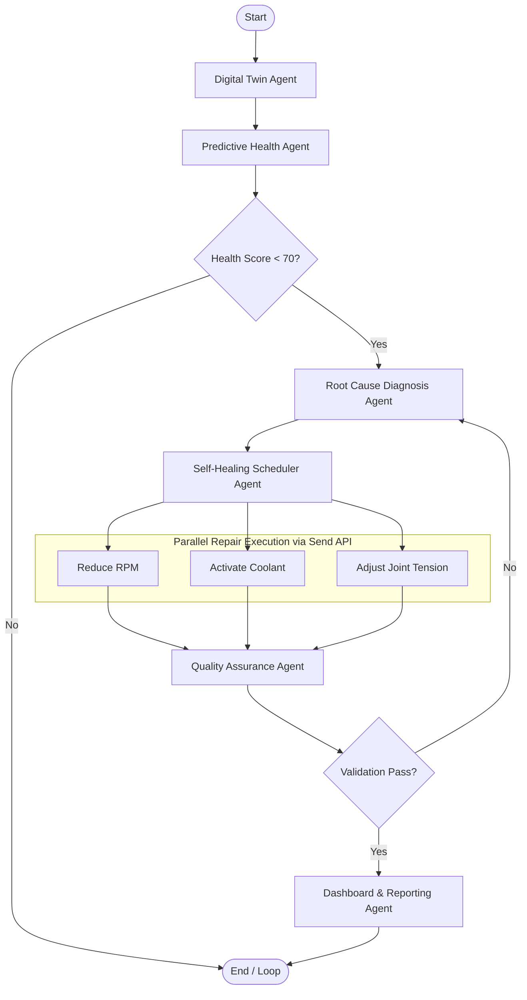

# ORION-FACTORY Architecture

ORION-FACTORY is a Self-Healing Manufacturing Digital Twin that orchestrates 6 specialized AI agents on a single LangGraph StateGraph.

## StateGraph Architecture

The workflow starts with continuous physics simulation, checks predictive health, and triggers a self-healing loop in parallel if any anomaly is detected, followed by validation and dashboard reporting.



## State Schema (OrionState)

```python
from typing import TypedDict, List

class OrionState(TypedDict):
    # Input Layer
    sensor_data: dict          # {"vibration": 0.5, "temp": 85}
    
    # Simulation Layer
    twin_state: dict           # MuJoCo position/velocity/torque data
    
    # Prediction Layer
    health_score: int          # 0-100
    failure_prob: float        # 0.0-1.0
    
    # Diagnosis Layer
    root_causes: List[str]     # Top diagnosed causes
    
    # Execution Layer
    repair_actions: List[dict] # Actions to take
    repair_status: str         # "PENDING", "RUNNING", "SUCCESS"
    
    # Validation Layer
    validation_result: bool    # True if repaired successfully
```
